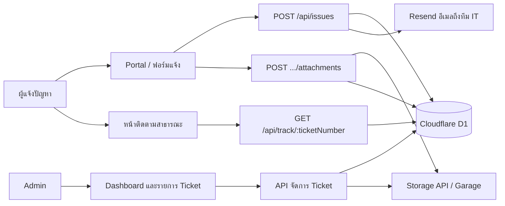

# IssueDesk

IssueDesk เป็นเว็บแอป IT Help Desk สำหรับแจ้งปัญหาภายในองค์กร ติดตามสถานะ Ticket และให้ผู้ดูแลระบบจัดการงานได้ในที่เดียว

ผู้แจ้งส่งรายละเอียดปัญหาพร้อมไฟล์แนบได้โดยไม่ต้องเข้าสู่ระบบ ระบบออกหมายเลข Ticket อัตโนมัติ แจ้งอีเมลไปยังทีม IT เมื่อมีเรื่องใหม่ และเปิดหน้าติดตามสาธารณะที่แสดงเฉพาะสถานะกับเวลา

ผู้ดูแลระบบเข้าสู่ระบบแล้วดู Dashboard เปลี่ยนสถานะ ดูไฟล์แนบ หรือลบ Ticket ได้จากหน้าจัดการ

เวอร์ชันปัจจุบัน: `1.0.1`

## ความสามารถ

### สำหรับผู้แจ้งปัญหา

- หน้า Portal สำหรับแจ้งปัญหาและค้นหา Ticket จากหมายเลข
- ฟอร์มแจ้งปัญหา: ชื่อผู้แจ้ง หัวข้อ หมวดหมู่ ความสำคัญ และรายละเอียด
- หมวดหมู่: Hardware, Software, Network, Printer, Other
- ความสำคัญ: Low, Medium, High (ค่าเริ่มต้น Medium)
- แนบภาพได้สูงสุด 5 ไฟล์ ไฟล์ละไม่เกิน 5 MB (JPEG, PNG, WebP, HEIC/HEIF) พร้อมตัวอย่างภาพ รวมถึงแปลง HEIC ในเบราว์เซอร์เพื่อแสดง preview
- หลังส่งสำเร็จ แสดงหมายเลข Ticket และคัดลอกไปคลิปบอร์ดได้
- ติดตาม Ticket จากหน้าสาธารณะด้วยหมายเลขรูปแบบ `IT-YYYYMM-NNNN`
- หน้าติดตามแสดงเฉพาะหมายเลข สถานะ และเวลา ไม่เปิดเผยรายละเอียดปัญหาหรือข้อมูลผู้แจ้ง
- สมัครสมาชิกและเข้าสู่ระบบด้วยอีเมลได้ แต่การแจ้งปัญหาไม่บังคับให้ล็อกอิน

### สำหรับผู้ดูแลระบบ

- Dashboard สรุปจำนวน Ticket ทั้งหมด, Open, In Progress และ Resolved พร้อมรายการล่าสุด
- รายการ Ticket ค้นหาและกรองตามสถานะหรือความสำคัญ
- ดูรายละเอียด Ticket เปลี่ยนสถานะ ดูตัวอย่างไฟล์แนบ ดาวน์โหลด และลบ Ticket พร้อมไฟล์ใน Storage
- เส้นทาง `/dashboard`, `/issues` และ `/issues/:ticketNumber` รวมถึง API จัดการ Ticket จำกัดเฉพาะ role `admin`

### ระบบสนับสนุน

- ออกหมายเลข Ticket ตามเดือนในโซนเวลา `Asia/Bangkok` เช่น `IT-202610-0001`
- ส่งอีเมลแจ้งเตือนทีม IT ผ่าน Resend ทันทีที่มี Ticket ใหม่
- เก็บไฟล์แนบผ่าน Storage API ภายนอก (Garage ผ่าน S3-compatible API) และเก็บเฉพาะ metadata ใน D1
- Session ใน HttpOnly Cookie อายุ 7 วัน ตรวจสิทธิ์ที่ Cloudflare Pages Functions
- ธีมสว่าง / มืด / ตามระบบ และ Web App Manifest สำหรับเปิดแบบ standalone

## เส้นทางการใช้งาน



1. ผู้แจ้งกรอกฟอร์มที่ `/report` ระบบสร้าง Ticket สถานะ `Open` แล้วส่งอีเมลแจ้งทีม IT
2. หากมีไฟล์แนบ เบราว์เซอร์อัปโหลดทีละไฟล์หลังสร้าง Ticket สำเร็จ
3. ผู้แจ้งเก็บหมายเลข Ticket แล้วเปิด `/track/:ticketNumber` เพื่อดูความคืบหน้า
4. Admin เข้าสู่ระบบที่ `/login` ดู Dashboard เปลี่ยนสถานะเป็น `In Progress` หรือ `Resolved`
5. เมื่อสถานะเป็น `In Progress` ครั้งแรก ระบบบันทึก `in_progress_at` เพื่อแสดงบนหน้าติดตาม

## เทคโนโลยี

| ส่วน | เทคโนโลยี |
| --- | --- |
| Frontend | React 19, React Router 7, Vite 8 |
| UI | Tailwind CSS v4, Base UI, Lucide, Geist |
| Backend | Cloudflare Pages Functions |
| Database | Cloudflare D1 (SQLite) |
| File storage | Storage API ภายนอก; เอกสารระบบจัดเก็บระบุ Garage ผ่าน S3-compatible API |
| Email | [Resend](https://resend.com) HTTP API |
| Auth | Session cookie + PBKDF2-SHA-256 (Web Crypto) |
| Package manager | pnpm |
| Code quality | ESLint |

> `wrangler.jsonc` ไม่มี R2 bucket binding โดยตรง Pages Functions ติดต่อ Storage API และ Resend ผ่าน URL กับ secrets ที่ตั้งค่าไว้ด้านล่าง

## โครงสร้างโปรเจกต์

```text
issuedesk/
├── functions/api/          # Cloudflare Pages Functions
│   ├── auth/               # register, login, logout, me, session helpers
│   ├── issues.js           # สร้าง Ticket + ส่งอีเมล และรายการ Ticket
│   ├── issues/             # รายละเอียด, สถานะ, ลบ, ไฟล์แนบ
│   ├── track/              # ติดตามสาธารณะ
│   ├── health.js
│   └── storage-health.js
├── migrations/             # D1 schema
├── scripts/bootstrap-admin.py
├── src/
│   ├── auth/               # AuthProvider, ProtectedRoute
│   ├── components/         # layout, dashboard, report form, theme
│   ├── pages/              # Portal, Report, Track, Login, Issues
│   └── services/issues.js
├── public/                 # manifest, ไอคอน, เอกสาร Storage API
├── wrangler.jsonc
└── package.json
```

## หน้าเว็บ

| เส้นทาง | ผู้ใช้ | หน้าที่ |
| --- | --- | --- |
| `/` | สาธารณะ | Portal แจ้งปัญหาและค้นหา Ticket |
| `/report` | สาธารณะ | ฟอร์มสร้าง Ticket และแนบภาพ |
| `/track/:ticketNumber` | สาธารณะ | ความคืบหน้าแบบจำกัดข้อมูล |
| `/login` | สาธารณะ | สมัครสมาชิกและเข้าสู่ระบบ |
| `/dashboard` | Admin | สถิติและ Ticket ล่าสุด |
| `/issues` | Admin | รายการ ค้นหา กรองสถานะ/ความสำคัญ |
| `/issues/:ticketNumber` | Admin | รายละเอียด เปลี่ยนสถานะ ไฟล์แนบ ลบ Ticket |

## สถานะ Ticket

| สถานะ | ความหมายบนหน้าติดตาม |
| --- | --- |
| `Open` | รับเรื่องแล้ว |
| `In Progress` | กำลังดำเนินการ |
| `Resolved` | แก้ไขเรียบร้อย |

หมายเลข Ticket สร้างจากคำนำหน้า `IT-YYYYMM-` ตามปฏิทินไทย (`Asia/Bangkok`) แล้วต่อด้วยเลขลำดับ 4 หลักของเดือนนั้น หน้าติดตามรับเฉพาะรูปแบบ `IT-` ตามด้วยตัวเลข 6 หลัก ปี-เดือน แล้วตามด้วยอย่างน้อย 4 หลัก

ขีดจำกัดข้อมูลตอนสร้าง Ticket:

- ชื่อผู้แจ้ง ไม่เกิน 100 ตัวอักษร
- หัวข้อ ไม่เกิน 200 ตัวอักษร
- รายละเอียด ไม่เกิน 5,000 ตัวอักษร

## การยืนยันตัวตนและความปลอดภัย

- บัญชีใหม่ได้ role `user` เสมอ Admin คนแรกสร้างด้วย `scripts/bootstrap-admin.py`
- รหัสผ่านยาว 12–128 ตัวอักษร แฮชด้วย PBKDF2-SHA-256 ที่ 100,000 iterations ตามเพดานที่ Cloudflare Workers รองรับ
- Login และ Register ตรวจ Origin ให้ตรงกับโดเมนของแอป
- Login จำกัด 10 ครั้งต่ออีเมลใน 1 ชั่วโมง Register จำกัด 5 ครั้งต่ออีเมลใน 1 ชั่วโมง
- โทเคน Session ส่งผ่าน Cookie `issuedesk_session` ที่เป็น HttpOnly, Secure, SameSite=Lax D1 เก็บเฉพาะ SHA-256 hash ของโทเคน
- Session มีอายุ 7 วัน ผู้ใช้ที่ `is_active = 0` เข้าไม่ได้แม้ยังมี Cookie
- API ติดตามสาธารณะคืนเฉพาะ `ticket_number`, `status`, `created_at`, `updated_at`, `in_progress_at`

## การแจ้งเตือนอีเมล

เมื่อ `POST /api/issues` สร้าง Ticket สำเร็จ Pages Function เรียก Resend เพื่อส่งอีเมลไปยังกล่องจดหมายของทีม IT

จดหมายมีทั้ง HTML และข้อความล้วน หัวข้อรูปแบบ `[IssueDesk] New Issue IT-YYYYMM-NNNN` และมีหมายเลข Ticket ชื่อผู้แจ้ง หัวข้อ หมวดหมู่ ความสำคัญ สถานะ เวลาที่ส่ง และรายละเอียด โดย escape HTML ก่อนใส่ในแม่แบบ

ค่าที่ต้องตั้งใน Cloudflare Pages (production/preview) หรือ `.dev.vars` (เครื่องพัฒนา):

| Secret | ความหมาย |
| --- | --- |
| `RESEND_API_KEY` | API key ของ Resend |
| `RESEND_FROM_EMAIL` | ผู้ส่งที่ verified กับ Resend เช่น `IssueDesk <noreply@example.com>` |
| `ISSUE_NOTIFICATION_EMAIL` | อีเมลผู้รับของทีม IT |

หากการส่งอีเมลล้มเหลว ระบบยังคงสร้าง Ticket สำเร็จ และบันทึกข้อผิดพลาดไว้ใน log ของ Worker การแจ้งปัญหาจึงไม่ถูกบล็อกเพราะอีเมล แต่ควรตรวจ secrets และโดเมนผู้ส่งใน Resend หากทีมไม่ได้รับจดหมาย

## ไฟล์แนบและ Storage API

ไฟล์จริงไม่อยู่ใน D1 ตาราง `issue_attachments` เก็บ `storage_file_id`, ชื่อไฟล์, MIME type, ขนาด และเวลาอัปโหลด

ฝั่งฟอร์มแจ้งปัญหาจำกัดภาพ 5 ไฟล์ ไฟล์ละ 5 MB ส่วน API อัปโหลดรับได้สูงสุด 10 MiB และชนิดไฟล์:

- ภาพ: JPEG, PNG, WebP, GIF, HEIC, HEIF
- เอกสาร: PDF, TXT, CSV, ZIP, DOCX, XLSX

การอัปโหลด ดาวน์โหลด และลบไฟล์ใช้ `STORAGE_API_URL` พร้อม Cloudflare Access service token (`CF_ACCESS_CLIENT_ID`, `CF_ACCESS_CLIENT_SECRET`) และ `STORAGE_APP_SECRET` เมื่อ Admin ลบ Ticket ระบบลบไฟล์ใน Storage ก่อน แล้วลบแถวใน D1

Pages Functions เข้าถึง private network ของ Storage API ไม่ได้อัตโนมัติ เอกสารใน `public/storage-docs-operations.md` แนะนำให้ใช้ HTTPS tunnel หรือ Cloudflare Access ห้ามเปิด Garage ตรงสู่สาธารณะเพื่อแก้ปัญหาการเชื่อมต่อ

รายละเอียดเพิ่มเติมของระบบจัดเก็บอยู่ที่:

- `STORAGE_README.md`
- `STORAGE_DOCS_ARCHITECTURE.md`
- `STORAGE_DOCS_API_REFERENCE.md`
- `STORAGE_DOCS_SECURITY.md`
- `STORAGE_DOCS_OPERATIOINS.md`
- `GARAGE_README.md`

## สิ่งที่ต้องเตรียม

- Node.js และ pnpm
- บัญชี Cloudflare ที่มีสิทธิ์ Pages และ D1 สำหรับ preview, deploy และ migration บน remote
- บัญชี Resend และโดเมนผู้ส่งที่ verified หากต้องการอีเมลแจ้งเตือน
- Storage API ที่ Pages Functions ติดต่อถึงได้ผ่าน HTTPS/Access หากต้องทดสอบไฟล์แนบ

## ติดตั้งและเริ่มพัฒนา

```sh
pnpm install
pnpm dev
```

`pnpm dev` เปิดเฉพาะ Vite สำหรับ frontend หากต้องการเรียก Pages Functions และ D1 ในเครื่อง ให้ใช้ local D1 แล้ว preview:

```sh
pnpm exec wrangler d1 migrations apply issuedesk-db --local
pnpm preview
```

`pnpm preview` จะ build frontend แล้วเปิด `wrangler pages dev` ตาม script ใน `package.json`

สร้างไฟล์ `.dev.vars` ในโฟลเดอร์โปรเจกต์สำหรับ secrets ในเครื่อง:

```dotenv
STORAGE_API_URL=
STORAGE_APP_SECRET=
CF_ACCESS_CLIENT_ID=
CF_ACCESS_CLIENT_SECRET=
RESEND_API_KEY=
RESEND_FROM_EMAIL=
ISSUE_NOTIFICATION_EMAIL=
```

อย่า commit `.dev.vars` หรือส่ง secrets ผ่าน source code, browser หรือ log ใน production ให้ตั้งค่าเดียวกันเป็น Cloudflare Pages secrets / environment variables ของโปรเจกต์ `issuedesk`

## คำสั่งที่ใช้บ่อย

| คำสั่ง | การทำงาน |
| --- | --- |
| `pnpm dev` | เปิด Vite dev server สำหรับ frontend |
| `pnpm lint` | ตรวจ JavaScript/JSX ด้วย ESLint |
| `pnpm build` | สร้าง production bundle ใน `dist/` |
| `pnpm preview` | build แล้วเปิด Pages Functions ในเครื่อง |
| `pnpm migrate` | แสดงสถานะ D1 migrations บน remote |
| `pnpm migrate-apply` | ใช้ migrations ที่ยังไม่รันกับ D1 remote |
| `pnpm deploy` | build แล้ว deploy ด้วย Wrangler Pages |
| `pnpm cf-typegen` | สร้าง Cloudflare environment types ด้วย Wrangler |

ตรวจ `wrangler.jsonc` และ Cloudflare project ให้ถูกต้องก่อน deploy หรือ apply migration บน remote

## Cloudflare และฐานข้อมูล

`wrangler.jsonc` กำหนด Pages output directory เป็น `dist` และ D1 binding ชื่อ `DB` ซึ่งชี้ไปยังฐานข้อมูล `issuedesk-db`

Migrations ใน repository:

| Migration | ตาราง/ข้อมูลที่สร้าง |
| --- | --- |
| `0001_create_issues.sql` | `issues` |
| `0002_create_issue_attachments.sql` | `issue_attachments` และ index ตาม Ticket |
| `0003_create_auth_tables.sql` | `users`, `sessions`, `login_attempts` และ index ที่เกี่ยวข้อง |
| `0004_add_issue_in_progress_at.sql` | คอลัมน์ `in_progress_at` เพื่อแสดงประวัติบนหน้าติดตาม |

ตารางหลัก:

| ตาราง | ใช้เก็บ |
| --- | --- |
| `issues` | Ticket, สถานะ, เวลาสร้าง/อัปเดต, เวลาเริ่มดำเนินการ |
| `issue_attachments` | metadata ของไฟล์แนบ และ `storage_file_id` |
| `users` | บัญชี อีเมล รหัสผ่านที่แฮชแล้ว และ role |
| `sessions` | hash ของโทเคน Session และวันหมดอายุ |
| `login_attempts` | ประวัติพยายามเข้าสู่ระบบ/สมัคร เพื่อจำกัดอัตรา |

ตรวจสอบหรือ apply migration บน remote:

```sh
pnpm migrate
pnpm migrate-apply
```

คำสั่งเหล่านี้เปลี่ยนหรืออ่านฐานข้อมูล remote ตามลำดับ ควรตรวจ environment และ migration ที่กำลังจะรันก่อนเสมอ

## API

สิทธิ์ด้านล่างอ้างอิงการตรวจสอบใน Pages Functions ปัจจุบัน

| Method | Route | สิทธิ์/หน้าที่ |
| --- | --- | --- |
| `GET` | `/api/health` | ตรวจการเชื่อมต่อ D1 |
| `GET` | `/api/storage-health` | ตรวจการเชื่อมต่อ Storage API |
| `POST` | `/api/auth/register` | สมัครสมาชิก; role ใหม่เป็น `user` เสมอ |
| `POST` | `/api/auth/login` | ตรวจรหัสผ่านและออก Session Cookie |
| `GET` | `/api/auth/me` | แสดงผู้ใช้ของ Session ปัจจุบัน |
| `POST` | `/api/auth/logout` | ยกเลิก Session และล้าง Cookie |
| `POST` | `/api/issues` | สร้าง Ticket แล้วพยายามส่งอีเมลแจ้งทีม IT |
| `GET` | `/api/issues` | รายการ Ticket; ต้องเป็น Admin |
| `GET` | `/api/issues/stats` | สถิติ Ticket; ต้องเป็น Admin |
| `GET` | `/api/issues/:ticketNumber` | รายละเอียด Ticket; ต้องเป็น Admin |
| `PATCH` | `/api/issues/:ticketNumber` | เปลี่ยนสถานะ Ticket; ต้องเป็น Admin |
| `DELETE` | `/api/issues/:ticketNumber` | ลบ Ticket และไฟล์แนบใน Storage; ต้องเป็น Admin |
| `GET` | `/api/issues/:ticketNumber/attachments` | รายการไฟล์แนบ; ต้องเป็น Admin |
| `POST` | `/api/issues/:ticketNumber/attachments` | อัปโหลดไฟล์แนบของ Ticket |
| `GET` | `/api/issues/:ticketNumber/attachments/:attachmentId` | ดาวน์โหลดหรือแสดงไฟล์; ต้องเป็น Admin |
| `DELETE` | `/api/issues/:ticketNumber/attachments/:attachmentId` | ลบไฟล์แนบ; ต้องเป็น Admin |
| `GET` | `/api/track/:ticketNumber` | ติดตามสาธารณะ; คืนเฉพาะหมายเลข สถานะ และเวลา |

## สร้าง Admin คนแรก

```sh
python3 scripts/bootstrap-admin.py
```

สคริปต์ถามชื่อ อีเมล และรหัสผ่านใน terminal จากนั้นต้องพิมพ์ `create` เพื่อยืนยันการเขียนไปยัง D1 remote จะสร้าง Admin ได้เฉพาะเมื่อยังไม่มีบัญชี role `admin` ห้ามส่งรหัสผ่านให้ผู้อื่นหรือวางไว้ใน command line

## สถานะโปรเจกต์

ระบบหลักพร้อมใช้งาน:

- Portal, แจ้งปัญหา, ติดตาม Ticket, Dashboard และจัดการ Ticket อยู่ใน `src/`
- Pages Functions สำหรับ Issue, Authentication, Ticket tracking, Storage และอีเมลอยู่ใน `functions/api/`
- Authentication และการคุมสิทธิ์ Admin เชื่อมกับ routes และ API แล้ว
- การสร้าง Ticket ส่งอีเมลแจ้งทีมผ่าน Resend เมื่อตั้ง secrets ครบ
- `scripts/bootstrap-admin.py` ใช้สร้าง Admin คนแรกแบบ interactive บน D1 remote

หลัง deploy ควรตรวจอย่างน้อย:

1. สมัคร/เข้าสู่ระบบ และการเข้าถึงหน้า Admin ด้วยบัญชีที่ไม่ใช่ Admin
2. แจ้ง Ticket ได้รับหมายเลข และอีเมลถึง `ISSUE_NOTIFICATION_EMAIL`
3. แนบภาพแล้ว Admin เปิดดู/ดาวน์โหลดได้
4. เปลี่ยนสถานะแล้วหน้าติดตามสาธารณะอัปเดตตามเวลา `created_at` / `in_progress_at` / `updated_at`
5. ลบ Ticket แล้วไฟล์ใน Storage หายตาม

## หมายเหตุการดูแลระบบ

- Build อาจเตือนว่า JavaScript bundle ใหญ่กว่า 500 kB ซึ่งเป็นงานปรับประสิทธิภาพ ไม่ได้บล็อกการใช้งาน
- Rate limiting ของ Login/Register นับตามอีเมล ไม่ได้จำกัดตาม IP
- หากอีเมลไม่ถึงผู้รับ ให้ตรวจ Resend dashboard, โดเมนผู้ส่ง และค่า `RESEND_FROM_EMAIL`
- หากอัปโหลดไฟล์ล้มเหลวหลังสร้าง Ticket สำเร็จ ผู้แจ้งยังมีหมายเลข Ticket แต่ต้องแนบไฟล์ใหม่หรือให้ Admin จัดการภายหลัง
