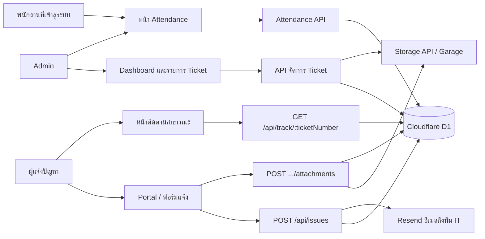

# IssueDesk

## Shared Storage Phase S1/S2 (2026-10-27)

S1 introduced the Storage Manager and Garage adapter and streams downloads. S2 adds additive folder/file metadata, internal `/v3` File Manager routes, pagination, duplicate-name enforcement, copy with size/SHA-256 verification, Trash/restore/permanent-delete flows and operation records. The existing app credential/project scope and `/v2` response formats remain; trashed entries are hidden from normal v2 list/download. `pnpm test` passes **27/27**, `pnpm lint` and `git diff --check` pass using fake S3 and in-memory SQLite. No migration was applied to the service database and nothing was deployed. Before running this version, apply the additive migration after a backup. See [Phase S2 report](garage/storage/PHASE_S2.md). Nexora backend and Phase 8 remain unimplemented.


> ดูสรุปโครงสร้างระบบ, API, migrations และจุดเริ่มต้นสำหรับงานต่อใน [PROJECT_HANDOFF.md](PROJECT_HANDOFF.md)

IssueDesk เป็นเว็บแอป IT Help Desk สำหรับแจ้งปัญหาภายในองค์กร ติดตามสถานะ Ticket และให้ผู้ดูแลระบบจัดการงานได้ในที่เดียว

ผู้แจ้งส่งรายละเอียดปัญหาพร้อมไฟล์แนบได้โดยไม่ต้องเข้าสู่ระบบ ระบบออกหมายเลข Ticket อัตโนมัติ แจ้งอีเมลไปยังทีม IT เมื่อมีเรื่องใหม่ และเปิดหน้าติดตามสาธารณะที่แสดงเฉพาะสถานะกับเวลา

ผู้ดูแลระบบเข้าสู่ระบบแล้วดู Dashboard เปลี่ยนสถานะ ดูไฟล์แนบ หรือลบ Ticket ได้จากหน้าจัดการ

เวอร์ชันปัจจุบัน: `1.3.3` (อ้างอิงจาก `package.json`)

## ความสามารถ

### สำหรับผู้แจ้งปัญหา

- หน้า Portal สำหรับแจ้งปัญหาและค้นหา Ticket จากหมายเลข
- ฟอร์มแจ้งปัญหา: ชื่อผู้แจ้ง หัวข้อ หมวดหมู่ ความสำคัญ และรายละเอียด
- หมวดหมู่: Hardware, Software, Network, Printer, Other
- ความสำคัญ: Low, Medium, High (ค่าเริ่มต้น Medium)
- แนบภาพได้สูงสุด 5 ไฟล์ ไฟล์ละไม่เกิน 5 MB (JPEG, PNG, WebP, HEIC/HEIF) พร้อมตัวอย่างภาพ รวมถึงแปลง HEIC ในเบราว์เซอร์เพื่อแสดง preview
- หลังส่งสำเร็จ แสดงหมายเลข Ticket และคัดลอกไปคลิปบอร์ดได้
- ติดตาม Ticket จากหน้าสาธารณะด้วยหมายเลขรูปแบบ `IT-YYYYMM-NNNN`
- หน้าติดตามแสดงเฉพาะหมายเลข สถานะ และเวลา ไม่เปิดเผยรายละเอียดปัญหาหรือข้อมูลผู้แจ้ง
- สมัครสมาชิกและเข้าสู่ระบบด้วยอีเมลได้ แต่การแจ้งปัญหาไม่บังคับให้ล็อกอิน

### สำหรับผู้ดูแลระบบ

- Dashboard สรุปจำนวน Ticket ทั้งหมด, Open, In Progress และ Resolved พร้อมรายการล่าสุด
- รายการ Ticket ค้นหาและกรองตามสถานะหรือความสำคัญ
- ดูรายละเอียด Ticket เปลี่ยนสถานะ ดูตัวอย่างไฟล์แนบ ดาวน์โหลด และลบ Ticket พร้อมไฟล์ใน Storage
- เส้นทาง `/dashboard`, `/issues` และ `/issues/:ticketNumber` รวมถึง API จัดการ Ticket จำกัดเฉพาะ role `admin`
- หน้า `/storage/images` จัดการภาพใน Storage และหน้า `/sheet` ดูทะเบียนอุปกรณ์จาก Google Sheets (Admin เท่านั้น)
- หน้า `/attendance` แสดงภาพรวมการลงเวลาของทีม ค้นหาด้วยชื่อ/อีเมล และกรองวันที่ (Admin ดูข้อมูลอย่างเดียว)

### ระบบลงเวลาทำงาน

- พนักงานที่เข้าสู่ระบบเช็คอินและเช็คเอาต์ของตนเองได้ พร้อมดูประวัติย้อนหลัง
- หน้าพนักงานแสดงวันและเวลาในเขตเวลา `Asia/Bangkok`; Timestamp บันทึกโดย server เป็น UTC ISO 8601
- Admin ดูจำนวนที่กำลังทำงาน เช็คเอาต์แล้ว และรายการค้างจากวันก่อน พร้อมค้นหา/กรอง/แบ่งหน้า
- หน้า User และ Admin แสดงเวลาทำงานสะสม; ประวัติและตาราง Admin แสดงระยะเวลารายการ โดยเวลาของรายการที่กำลังทำงานวันนี้อัปเดตทุกนาที
- หนึ่งรายการต่อผู้ใช้ต่อวัน; ยังไม่รองรับหลายกะ กะข้ามวัน การแก้เวลา ยืนยันรายการ OT วันหยุด หรือ Grace Period
- รายการที่ยังทำงานจากวันก่อนแสดงเป็นรายการผิดปกติ โดยระบบไม่สร้างเวลาเช็คเอาต์ให้เอง

### QR Code Studio

- สร้าง QR จาก URL, Text หรือ Short Link พร้อมปรับสีและโลโก้ แล้วดาวน์โหลด PNG/SVG
- บันทึกและแก้ไข QR ของตนเอง จัดการปลายทางและเปิด/ปิด Short Link ได้
- พัฒนา V1 ครบแล้ว อยู่ระหว่างทดลองใช้งานจริงก่อนปิดงาน ดูรายละเอียดและสถานะใน [QR Code Studio V1](#qr-code-studio-v1)

### Image Converter

- ผู้ใช้ที่เข้าสู่ระบบเปิด `/image-converter` เพื่อแปลงภาพเป็น AVIF, WebP, JPG หรือ PNG และปรับขนาดได้
- ตั้งคุณภาพภาพและเลือกคงสัดส่วนได้; เลือกหลายไฟล์เพื่อแปลงและดาวน์โหลดผลลัพธ์เป็น ZIP
- ประมวลผลใน browser โดยใช้ไฟล์จากเครื่องผู้ใช้

### ระบบสนับสนุน

- ออกหมายเลข Ticket ตามเดือนในโซนเวลา `Asia/Bangkok` เช่น `IT-202610-0001`
- ส่งอีเมลแจ้งเตือนทีม IT ผ่าน Resend ทันทีที่มี Ticket ใหม่
- เก็บไฟล์แนบผ่าน Storage API ภายนอก (Garage ผ่าน S3-compatible API) และเก็บเฉพาะ metadata ใน D1
- Session ใน HttpOnly Cookie อายุ 7 วัน ตรวจสิทธิ์ที่ Cloudflare Pages Functions
- ธีมสว่าง / มืด / ตามระบบ และ Web App Manifest สำหรับเปิดแบบ standalone

## เส้นทางการใช้งาน



1. ผู้แจ้งกรอกฟอร์มที่ `/report` ระบบสร้าง Ticket สถานะ `Open` แล้วส่งอีเมลแจ้งทีม IT
2. หากมีไฟล์แนบ เบราว์เซอร์อัปโหลดทีละไฟล์หลังสร้าง Ticket สำเร็จ
3. ผู้แจ้งเก็บหมายเลข Ticket แล้วเปิด `/track/:ticketNumber` เพื่อดูความคืบหน้า
4. Admin เข้าสู่ระบบที่ `/login` ดู Dashboard เปลี่ยนสถานะเป็น `In Progress` หรือ `Resolved`
5. เมื่อสถานะเป็น `In Progress` ครั้งแรก ระบบบันทึก `in_progress_at` เพื่อแสดงบนหน้าติดตาม

## เทคโนโลยี

| ส่วน | เทคโนโลยี |
| --- | --- |
| Frontend | React 19, React Router 7, Vite 8 |
| UI | Tailwind CSS v4, Base UI, Lucide, Geist |
| Backend | Cloudflare Pages Functions |
| Database | Cloudflare D1 (SQLite) |
| File storage | Storage API ภายนอก; เอกสารระบบจัดเก็บระบุ Garage ผ่าน S3-compatible API |
| Email | [Resend](https://resend.com) HTTP API |
| Auth | Session cookie + PBKDF2-SHA-256 (Web Crypto) |
| QR rendering | qr-code-styling; สร้าง preview และ export ใน browser |
| Package manager | pnpm |
| Code quality | ESLint |

> `wrangler.jsonc` ไม่มี R2 bucket binding โดยตรง Pages Functions ติดต่อ Storage API และ Resend ผ่าน URL กับ secrets ที่ตั้งค่าไว้ด้านล่าง

## โครงสร้างโปรเจกต์

```text
issuedesk/
├── functions/api/          # Cloudflare Pages Functions
│   ├── auth/               # register, login, logout, me, session helpers
│   ├── attendance/         # today, check-in, check-out, history
│   ├── admin/attendance/   # summary และ records สำหรับ Admin
│   ├── network/            # status/history/events, viewer lease, ping และ agent APIs
│   ├── storage/            # admin management และ authenticated file proxy
│   ├── issues.js           # สร้าง Ticket + ส่งอีเมล และรายการ Ticket
│   ├── issues/             # รายละเอียด, สถานะ, ลบ, ไฟล์แนบ
│   ├── qr-codes/           # CRUD QR ของสมาชิก
│   ├── short-links/        # CRUD และตรวจ slug ของ Short Link
│   ├── qr-logos/           # อัปโหลด/อ่านโลโก้ตามเจ้าของ
│   ├── track/              # ติดตามสาธารณะ
│   ├── health.js
│   └── storage-health.js
├── functions/q/[slug].js   # public Short Link redirect 302
├── migrations/             # D1 schema
├── scripts/bootstrap-admin.py
├── scripts/qr-studio-dev.mjs   # local QR sandbox: pnpm dev:qr
├── scripts/qr-studio-checks.mjs # QR regression: pnpm test:qr
├── src/
│   ├── auth/               # AuthProvider, ProtectedRoute
│   ├── components/         # layout, dashboard, report form, theme
│   ├── pages/qr/           # Create QR, Short Links, My QR Codes
│   ├── pages/              # Portal, Report, Track, Login, Issues
│   └── services/issues.js
├── public/                 # manifest, ไอคอน, เอกสาร Storage API
├── wrangler.jsonc
└── package.json
```

## หน้าเว็บ

| เส้นทาง | ผู้ใช้ | หน้าที่ |
| --- | --- | --- |
| `/` | สาธารณะ | Portal แจ้งปัญหาและค้นหา Ticket |
| `/report` | สาธารณะ | ฟอร์มสร้าง Ticket และแนบภาพ |
| `/track/:ticketNumber` | สาธารณะ | ความคืบหน้าแบบจำกัดข้อมูล |
| `/login` | สาธารณะ | สมัครสมาชิกและเข้าสู่ระบบ |
| `/dashboard` | Admin | สถิติและ Ticket ล่าสุด |
| `/issues` | Admin | รายการ ค้นหา กรองสถานะ/ความสำคัญ |
| `/issues/:ticketNumber` | Admin | รายละเอียด เปลี่ยนสถานะ ไฟล์แนบ ลบ Ticket |
| `/storage/images` | Admin | จัดการภาพใน Storage: ดูตัวอย่าง อัปโหลด ดาวน์โหลด ลบ และคัดลอกลิงก์ |
| `/sheet` | Admin | ทะเบียนอุปกรณ์จาก Google Sheets; ค้นหา กรองสถานะ และดูรูปอุปกรณ์ |
| `/attendance` | ผู้ใช้ที่เข้าสู่ระบบ | พนักงานเช็คอิน/เช็คเอาต์และดูประวัติ; Admin ดูภาพรวมและรายการของทีม |
| `/qr-studio` | ผู้ใช้ที่เข้าสู่ระบบ | Create QR: ปรับเนื้อหา/ดีไซน์ ดู preview บันทึก และ export |
| `/qr-studio/links` | ผู้ใช้ที่เข้าสู่ระบบ | จัดการ Short Links ของตนเอง |
| `/qr-studio/saved` | ผู้ใช้ที่เข้าสู่ระบบ | My QR Codes: ค้นหา เปิดแก้ไข ดาวน์โหลด และลบ QR ของตนเอง |
| `/image-converter` | ผู้ใช้ที่เข้าสู่ระบบ | แปลงและปรับขนาดหลายภาพ แล้วดาวน์โหลดเป็น ZIP |
| `/q/:slug` | สาธารณะ | redirect 302 ไปปลายทางของ Short Link ที่ active |

## Image Storage API

API กลุ่มนี้เป็น proxy ของ IssueDesk ไปยัง Storage API ใช้ Cookie session ของ IssueDesk การเรียกรายการ อัปโหลด ลบ และดาวน์โหลดไฟล์ที่ไม่ใช่ภาพจำกัดเฉพาะ Admin ส่วนการดู/ดาวน์โหลดภาพ raster ที่รองรับเปิดให้สมาชิกที่มี session ทุกคำขอจากหน้าเว็บควรเรียก API ผ่าน `src/services/storage.js` เพื่อให้แนบ session cookie แบบ same-origin โดยอัตโนมัติ ค่า credential ของ Storage และ Cloudflare Access อยู่ฝั่ง Pages Functions เท่านั้น

| Method | Endpoint | การทำงาน |
| --- | --- | --- |
| `GET` | `/api/storage/files` | แสดงรายการไฟล์ทั้งหมดจาก Storage เรียงใหม่ไปเก่า |
| `POST` | `/api/storage/files` | อัปโหลดไฟล์ด้วย `multipart/form-data` field ชื่อ `file` |
| `GET` | `/api/storage/files/:fileId` | ผู้ใช้ที่ล็อกอินดูรูปที่รองรับแบบ inline ได้ |
| `GET` | `/api/storage/files/:fileId?download=1&name=:fileName` | ผู้ใช้ที่ล็อกอินดาวน์โหลดรูปได้; ดาวน์โหลดไฟล์ชนิดอื่นและจัดการไฟล์ต้องเป็น Admin |
| `DELETE` | `/api/storage/files/:fileId` | ลบไฟล์จาก Storage และล้างแถว `issue_attachments` ที่อ้างถึงไฟล์นั้นใน D1 |

### ตัวอย่างเรียก API

แสดงรายการ (ผู้ใช้ต้องมี session Admin ที่ยังใช้งานได้):

```http
GET /api/storage/files
```

ตัวอย่าง response:

```json
{
  "success": true,
  "files": [
    {
      "id": "<file-id>",
      "file_name": "screen.png",
      "mime_type": "image/png",
      "file_size": 24576,
      "uploaded_at": "2026-10-21T09:30:00.000Z"
    }
  ]
}
```

อัปโหลดจากเบราว์เซอร์:

```js
const form = new FormData();
form.append("file", imageFile);
const response = await fetch("/api/storage/files", { method: "POST", body: form });
const result = await response.json();
```

รองรับรูปภาพ เอกสาร Office/iWork, PDF, ไฟล์บีบอัด, ข้อความ, เสียง และวิดีโอตาม MIME type ที่กำหนด ขนาดมากกว่า 0 และไม่เกิน 10 MiB; server เป็นผู้ตรวจชนิดและขนาดไฟล์อีกครั้ง ตัวอย่าง response (HTTP `201`):

```json
{
  "success": true,
  "file": {
    "id": "<file-id>",
    "file_name": "screen.png",
    "mime_type": "image/png",
    "file_size": 24576,
    "uploaded_at": "2026-10-21T09:30:00.000Z"
  }
}
```

หน้า `/storage/images` รองรับอัปโหลดหลายไฟล์ โดยส่งทีละไฟล์ไม่เกิน 10 MiB พร้อมกันสูงสุด 3 รายการ ชนิดไฟล์รวมถึงรูปภาพ PDF, Office/iWork, ZIP/RAR/7z/GZIP, TXT/CSV/Markdown/JSON/XML/HTML/CSS/JavaScript และเสียง/วิดีโอ รูป raster ที่อนุญาตเปิด preview ผ่าน URL `/api/storage/files/:fileId`; ไฟล์อื่นดาวน์โหลดด้วย query `download=1` ชื่อไฟล์ส่งผ่าน `name` ได้ โดย server กรองอักขระเส้นทางและขึ้นบรรทัดใหม่ก่อนใช้เป็นชื่อดาวน์โหลด ลิงก์จากหน้า Storage ต้องใช้ Admin session ไม่ใช่ public link

ลบไฟล์:

```http
DELETE /api/storage/files/:fileId
```

```json
{
  "success": true,
  "message": "Image deleted successfully"
}
```

เมื่อ Storage แจ้งว่าไม่พบไฟล์ (404) ระบบถือว่าไฟล์ถูกลบแล้วและยังดำเนินการล้างข้อมูลแนบใน D1 ต่อ หากลบไฟล์สำเร็จแต่ล้าง D1 ไม่สำเร็จ API ตอบ `500` พร้อมข้อความแจ้งว่าลบจาก Storage แล้วแต่ล้างข้อมูลที่เชื่อมโยงไม่สำเร็จ

### รหัสตอบกลับที่พบบ่อย

| HTTP | ความหมาย |
| --- | --- |
| `400` | ขาดไฟล์หรือ request ไม่ถูกต้อง |
| `401` | ไม่มี session หรือ session หมดอายุ |
| `403` | ผู้ใช้ไม่มี role Admin |
| `404` | ไม่พบรูป |
| `413` | รูปใหญ่กว่า 10 MiB |
| `415` | ชนิดไฟล์ไม่รองรับ หรือ preview ไม่ใช่รูป raster ที่อนุญาต |
| `500` | ตั้งค่า Storage ไม่ครบ หรือเกิดปัญหาล้างข้อมูลอ้างอิงใน D1 |
| `502` | Storage API ติดต่อไม่ได้หรือตอบกลับผิดพลาด |

## สถานะ Ticket

| สถานะ | ความหมายบนหน้าติดตาม |
| --- | --- |
| `Open` | รับเรื่องแล้ว |
| `In Progress` | กำลังดำเนินการ |
| `Resolved` | แก้ไขเรียบร้อย |

หมายเลข Ticket สร้างจากคำนำหน้า `IT-YYYYMM-` ตามปฏิทินไทย (`Asia/Bangkok`) แล้วต่อด้วยเลขลำดับ 4 หลักของเดือนนั้น หน้าติดตามรับเฉพาะรูปแบบ `IT-` ตามด้วยตัวเลข 6 หลัก ปี-เดือน แล้วตามด้วยอย่างน้อย 4 หลัก

ขีดจำกัดข้อมูลตอนสร้าง Ticket:

- ชื่อผู้แจ้ง ไม่เกิน 100 ตัวอักษร
- หัวข้อ ไม่เกิน 200 ตัวอักษร
- รายละเอียด ไม่เกิน 5,000 ตัวอักษร

## การยืนยันตัวตนและความปลอดภัย

- บัญชีใหม่ได้ role `user` เสมอ Admin คนแรกสร้างด้วย `scripts/bootstrap-admin.py`
- รหัสผ่านยาว 12–128 ตัวอักษร แฮชด้วย PBKDF2-SHA-256 ที่ 100,000 iterations ตามเพดานที่ Cloudflare Workers รองรับ
- Login และ Register ตรวจ Origin ให้ตรงกับโดเมนของแอป
- Login จำกัด 10 ครั้งต่ออีเมลใน 1 ชั่วโมง Register จำกัด 5 ครั้งต่ออีเมลใน 1 ชั่วโมง
- โทเคน Session ส่งผ่าน Cookie `issuedesk_session` ที่เป็น HttpOnly, Secure, SameSite=Lax D1 เก็บเฉพาะ SHA-256 hash ของโทเคน
- Session มีอายุ 7 วัน ผู้ใช้ที่ `is_active = 0` เข้าไม่ได้แม้ยังมี Cookie
- API ติดตามสาธารณะคืนเฉพาะ `ticket_number`, `status`, `created_at`, `updated_at`, `in_progress_at`

## การแจ้งเตือนอีเมล

เมื่อ `POST /api/issues` สร้าง Ticket สำเร็จ Pages Function เรียก Resend เพื่อส่งอีเมลไปยังกล่องจดหมายของทีม IT

หากต้องการใช้ Resend จากเว็บไซต์อื่น เช่น Portfolio ให้ใช้ `POST /api/resend` ตามคู่มือแยก [RESEND_API.md](RESEND_API.md) โดยตั้ง allowlist ของ Origin และผู้รับอีเมลบน Cloudflare Pages ก่อน

จดหมายมีทั้ง HTML และข้อความล้วน หัวข้อรูปแบบ `[IssueDesk] New Issue IT-YYYYMM-NNNN` และมีหมายเลข Ticket ชื่อผู้แจ้ง หัวข้อ หมวดหมู่ ความสำคัญ สถานะ เวลาที่ส่ง และรายละเอียด โดย escape HTML ก่อนใส่ในแม่แบบ

ค่าที่ต้องตั้งใน Cloudflare Pages (production/preview) หรือ `.dev.vars` (เครื่องพัฒนา):

| Secret | ความหมาย |
| --- | --- |
| `RESEND_API_KEY` | API key ของ Resend |
| `RESEND_FROM_EMAIL` | ผู้ส่งที่ verified กับ Resend เช่น `IssueDesk <noreply@example.com>` |
| `ISSUE_NOTIFICATION_EMAIL` | อีเมลผู้รับของทีม IT |

หากการส่งอีเมลล้มเหลว ระบบยังคงสร้าง Ticket สำเร็จ และบันทึกข้อผิดพลาดไว้ใน log ของ Worker การแจ้งปัญหาจึงไม่ถูกบล็อกเพราะอีเมล แต่ควรตรวจ secrets และโดเมนผู้ส่งใน Resend หากทีมไม่ได้รับจดหมาย

## ไฟล์แนบและ Storage API

ไฟล์จริงไม่อยู่ใน D1 ตาราง `issue_attachments` เก็บ `storage_file_id`, ชื่อไฟล์, MIME type, ขนาด และเวลาอัปโหลด

ฝั่งฟอร์มแจ้งปัญหาจำกัดภาพ 5 ไฟล์ ไฟล์ละ 5 MB ส่วน API อัปโหลดรับได้สูงสุด 10 MiB และชนิดไฟล์:

- ภาพ: JPEG, PNG, WebP, GIF, HEIC, HEIF
- เอกสาร: PDF, TXT, CSV, ZIP, DOCX, XLSX

การอัปโหลด ดาวน์โหลด และลบไฟล์ใช้ `STORAGE_API_URL` พร้อม Cloudflare Access service token (`CF_ACCESS_CLIENT_ID`, `CF_ACCESS_CLIENT_SECRET`) และ `STORAGE_APP_SECRET` เมื่อ Admin ลบ Ticket ระบบลบไฟล์ใน Storage ก่อน แล้วลบแถวใน D1

Pages Functions เข้าถึง private network ของ Storage API ไม่ได้อัตโนมัติ เอกสารใน `public/storage-docs-operations.md` แนะนำให้ใช้ HTTPS tunnel หรือ Cloudflare Access ห้ามเปิด Garage ตรงสู่สาธารณะเพื่อแก้ปัญหาการเชื่อมต่อ

รายละเอียดเพิ่มเติมของระบบจัดเก็บอยู่ที่:

- `STORAGE_README.md`
- `STORAGE_DOCS_ARCHITECTURE.md`
- `STORAGE_DOCS_API_REFERENCE.md`
- `STORAGE_DOCS_SECURITY.md`
- `STORAGE_DOCS_OPERATIOINS.md`
- `GARAGE_README.md`

## สิ่งที่ต้องเตรียม

- Node.js และ pnpm
- บัญชี Cloudflare ที่มีสิทธิ์ Pages และ D1 สำหรับ preview, deploy และ migration บน remote
- บัญชี Resend และโดเมนผู้ส่งที่ verified หากต้องการอีเมลแจ้งเตือน
- Storage API ที่ Pages Functions ติดต่อถึงได้ผ่าน HTTPS/Access หากต้องทดสอบไฟล์แนบ

## ติดตั้งและเริ่มพัฒนา

```sh
pnpm install
pnpm dev
```

`pnpm dev` เปิดเฉพาะ Vite สำหรับ frontend หากต้องการเรียก Pages Functions และ D1 ในเครื่อง ให้ใช้ local D1 แล้ว preview:

```sh
pnpm exec wrangler d1 migrations apply issuedesk-db --local
pnpm preview
```

`pnpm preview` จะ build frontend แล้วเปิด `wrangler pages dev` ตาม script ใน `package.json`

สร้างไฟล์ `.dev.vars` ในโฟลเดอร์โปรเจกต์สำหรับ secrets ในเครื่อง:

```dotenv
STORAGE_API_URL=
STORAGE_APP_SECRET=
CF_ACCESS_CLIENT_ID=
CF_ACCESS_CLIENT_SECRET=
RESEND_API_KEY=
RESEND_FROM_EMAIL=
ISSUE_NOTIFICATION_EMAIL=
GOOGLE_CLIENT_ID=
GOOGLE_CLIENT_SECRET=
FACEBOOK_CLIENT_ID=
FACEBOOK_CLIENT_SECRET=
# Optional; Facebook Graph API version, defaults to v26.0
FACEBOOK_GRAPH_API_VERSION=
```

อย่า commit `.dev.vars` หรือส่ง secrets ผ่าน source code, browser หรือ log ใน production ให้ตั้งค่าเดียวกันเป็น Cloudflare Pages secrets / environment variables ของโปรเจกต์ `issuedesk`

### Social sign-in (Google และ Facebook)

ตั้ง `GOOGLE_CLIENT_ID`, `GOOGLE_CLIENT_SECRET`, `FACEBOOK_CLIENT_ID` และ `FACEBOOK_CLIENT_SECRET` ใน `.dev.vars` และ Cloudflare Pages environments ที่ต้องการใช้ (production/preview แยกกัน) จากนั้นเพิ่ม Authorized redirect URI ในหน้า OAuth ของแต่ละ provider ให้ตรงกับ origin ของแอป:

```text
https://<your-issuedesk-domain>/api/auth/oauth/callback/google
https://<your-issuedesk-domain>/api/auth/oauth/callback/facebook
```

สำหรับ local Pages preview ให้เพิ่ม callback URI ที่ใช้จริง เช่น `http://localhost:8788/api/auth/oauth/callback/google` และ Facebook callback ตามลำดับ Google ขอ scope `openid email profile`; Facebook ขอ `email,public_profile` บัญชีใหม่จะได้ role `user` และ identity ของ provider ถูกเก็บในตาราง `oauth_accounts` โดยไม่ผูกบัญชีเดิมอัตโนมัติด้วยอีเมล หากอีเมลมีบัญชีอยู่แล้ว ให้เข้าสู่ระบบด้วยรหัสผ่านก่อน (การเชื่อมบัญชียังไม่รองรับ)

ใช้ Facebook Login app ที่เปิดใช้งานและอนุญาตสิทธิ์ email แล้ว หากตั้งค่า `FACEBOOK_GRAPH_API_VERSION` ให้เป็น Graph API version ที่แอป Meta ของคุณรองรับ; ถ้าไม่ตั้ง ระบบใช้ `v26.0` เป็นค่าเริ่มต้น ([Meta Graph API versions](https://developers.facebook.com/docs/graph-api/changelog/versions/)).

Migration `0005_create_oauth_accounts.sql` ต้องถูกนำไปใช้กับ D1 ก่อนเปิด Social sign-in ใน environment นั้น

## คำสั่งที่ใช้บ่อย

| คำสั่ง | การทำงาน |
| --- | --- |
| `pnpm dev` | เปิด Vite dev server สำหรับ frontend |
| `pnpm lint` | ตรวจ JavaScript/JSX ด้วย ESLint |
| `pnpm build` | สร้าง production bundle ใน `dist/` |
| `pnpm preview` | build แล้วเปิด Pages Functions ในเครื่อง |
| `pnpm migrate` | แสดงสถานะ D1 migrations บน remote |
| `pnpm migrate-apply` | ใช้ migrations ที่ยังไม่รันกับ D1 remote |
| `pnpm deploy` | build แล้ว deploy ด้วย Wrangler Pages |
| `pnpm cf-typegen` | สร้าง Cloudflare environment types ด้วย Wrangler |

ตรวจ `wrangler.jsonc` และ Cloudflare project ให้ถูกต้องก่อน deploy หรือ apply migration บน remote

## Cloudflare และฐานข้อมูล

`wrangler.jsonc` กำหนด Pages output directory เป็น `dist` และ D1 binding ชื่อ `DB` ซึ่งชี้ไปยังฐานข้อมูล `issuedesk-db`

Migrations ใน repository:

| Migration | ตาราง/ข้อมูลที่สร้าง |
| --- | --- |
| `0001_create_issues.sql` | `issues` |
| `0002_create_issue_attachments.sql` | `issue_attachments` และ index ตาม Ticket |
| `0003_create_auth_tables.sql` | `users`, `sessions`, `login_attempts` และ index ที่เกี่ยวข้อง |
| `0004_add_issue_in_progress_at.sql` | คอลัมน์ `in_progress_at` เพื่อแสดงประวัติบนหน้าติดตาม |
| `0005_create_oauth_accounts.sql` | ตาราง `oauth_accounts` สำหรับเชื่อม provider identity กับบัญชีผู้ใช้ |
| `0006_create_attendance_records.sql` | ตาราง `attendance_records` และ index สำหรับระบบลงเวลา |

ตารางหลัก:

| ตาราง | ใช้เก็บ |
| --- | --- |
| `issues` | Ticket, สถานะ, เวลาสร้าง/อัปเดต, เวลาเริ่มดำเนินการ |
| `issue_attachments` | metadata ของไฟล์แนบ และ `storage_file_id` |
| `users` | บัญชี อีเมล รหัสผ่านที่แฮชแล้ว และ role |
| `sessions` | hash ของโทเคน Session และวันหมดอายุ |
| `login_attempts` | ประวัติพยายามเข้าสู่ระบบ/สมัคร เพื่อจำกัดอัตรา |
| `attendance_records` | วันทำงาน เวลาเช็คอิน/เช็คเอาต์ สถานะ และเจ้าของรายการ |

ตรวจสอบหรือ apply migration บน remote:

```sh
pnpm migrate
pnpm migrate-apply
```

คำสั่งเหล่านี้เปลี่ยนหรืออ่านฐานข้อมูล remote ตามลำดับ ควรตรวจ environment และ migration ที่กำลังจะรันก่อนเสมอ

## API

รายการนี้ตรวจจาก exports `onRequestGet/Post/Patch/Delete` ใน `functions/api/` เมื่อ 26 ตุลาคม 2026 ครบ **37 ไฟล์ endpoint / 53 คู่ method + route** และแยก helper 6 ไฟล์ออกจาก API สาธารณะ ตารางอธิบายพฤติกรรมใน source ไม่ได้ยืนยันว่า configuration, migrations หรือบริการภายนอกพร้อมในทุก environment

ความหมายของสิทธิ์:

- **สาธารณะ**: handler ไม่บังคับ session; endpoint ที่ระบุ same-origin ยังต้องส่ง `Origin` ตรงกับโดเมนแอป
- **Session**: ต้องมี `issuedesk_session` ที่ยังใช้ได้และบัญชี active; Admin เข้าถึง endpoint ระดับ Session ได้ด้วย
- **Admin**: ตรวจ role `admin` ใน Pages Function
- **เจ้าของ**: ตรวจ session และ scope ข้อมูลด้วยเจ้าของปัจจุบัน; Admin ไม่ข้าม ownership ของ QR/Short Link/โลโก้
- **Agent**: ใช้ `Authorization: Bearer <NETWORK_AGENT_TOKEN>` ผ่าน `authorizeAgent()` แยกจาก cookie session และ Cloudflare Access service credentials

### Health และการเชื่อมต่อ

Source: [health.js](functions/api/health.js), [storage-health.js](functions/api/storage-health.js)

| Method | Route | สิทธิ์ | หน้าที่/ข้อมูลสำคัญ |
| --- | --- | --- | --- |
| `GET` | `/api/health` | สาธารณะ | ตรวจ D1 ด้วย `SELECT 1`; ไม่ใช่การตรวจ schema/migrations ทั้งหมด |
| `GET` | `/api/storage-health` | สาธารณะ | ตรวจ configuration และการเรียกรายการไฟล์ของ Storage project; คืนสถานะเชื่อมต่อและจำนวนไฟล์ ไม่ใช่การทดสอบ upload |

### Authentication และ OAuth

Source: [functions/api/auth/](functions/api/auth/)

| Method | Route | สิทธิ์ | หน้าที่/ข้อมูลสำคัญ |
| --- | --- | --- | --- |
| `POST` | `/api/auth/register` | สาธารณะ + same-origin | JSON `name`, `email`, `password`; สร้าง role `user`, คืน 201; ไม่ออก session ให้อัตโนมัติ; มี rate limit |
| `POST` | `/api/auth/login` | สาธารณะ + same-origin | JSON `email`, `password`; ตรวจบัญชี active/รหัสผ่าน แล้วออก HttpOnly session cookie; มี rate limit |
| `GET` | `/api/auth/me` | Session | คืน `user` ของ session; ไม่มี session ที่ใช้ได้คืน 401 |
| `POST` | `/api/auth/logout` | same-origin; session optional | revoke token ถ้ามี แล้วล้าง cookie; ไม่บังคับว่าต้องมี session ที่ยัง active |
| `GET` | `/api/auth/oauth` | สาธารณะ | query `provider=google` หรือ `provider=facebook`; ตั้ง state cookie แล้ว redirect ไป provider เมื่อ configured |
| `GET` | `/api/auth/oauth/callback/:provider` | สาธารณะ + OAuth state cookie | query `code`, `state` หรือ provider error; ตรวจ state/account mapping, ออก session แล้ว redirect; ไม่ใช่ JSON endpoint |

OAuth มี routes ไม่ได้แปลว่า provider พร้อมใช้งาน ต้องตั้งค่า credentials/callback ให้ตรงกับ environment และมี state cookie ที่ถูกต้องก่อน callback

### Tickets และ public tracking

Source: [issues.js](functions/api/issues.js), [functions/api/issues/](functions/api/issues/), [track/[ticketNumber].js](functions/api/track/[ticketNumber].js)

| Method | Route | สิทธิ์ | หน้าที่/ข้อมูลสำคัญ |
| --- | --- | --- | --- |
| `POST` | `/api/issues` | สาธารณะ | JSON `reporter`, `title`, `category`, `priority`, `description`; สร้าง Ticket `Open`, คืน 201 และพยายามส่งอีเมล; email ล้มเหลวไม่ยกเลิก Ticket |
| `GET` | `/api/issues` | Admin | รายการ Ticket ล่าสุดพร้อมจำนวนไฟล์แนบ; query `limit` ค่าเริ่มต้น 20 สูงสุด 100; ไม่มี server-side search/status filter ใน handler นี้ |
| `GET` | `/api/issues/stats` | Admin | จำนวน Ticket ทั้งหมดและแยก `Open`, `In Progress`, `Resolved` |
| `GET` | `/api/issues/:ticketNumber` | Admin | อ่านรายละเอียด Ticket |
| `PATCH` | `/api/issues/:ticketNumber` | Admin | JSON `status` เป็น `Open`, `In Progress` หรือ `Resolved`; อัปเดตสถานะและ timestamp ตามโค้ด |
| `DELETE` | `/api/issues/:ticketNumber` | Admin | ลบ Ticket และจัดการไฟล์แนบ/metadata ที่เกี่ยวข้อง |
| `GET` | `/api/track/:ticketNumber` | สาธารณะ | คืนเฉพาะ `ticket_number`, `status`, `created_at`, `updated_at`, `in_progress_at`; ไม่คืน reporter/issue details |

### ไฟล์แนบของ Ticket

Source: [attachments/index.js](functions/api/issues/[ticketNumber]/attachments/index.js), [attachments/[attachmentId].js](functions/api/issues/[ticketNumber]/attachments/[attachmentId].js)

| Method | Route | สิทธิ์ | หน้าที่/ข้อมูลสำคัญ |
| --- | --- | --- | --- |
| `GET` | `/api/issues/:ticketNumber/attachments` | Admin | รายการ metadata ไฟล์แนบของ Ticket |
| `POST` | `/api/issues/:ticketNumber/attachments` | สาธารณะ | `multipart/form-data` field `file`; ตรวจว่า Ticket มีอยู่และชนิด/ขนาดไฟล์ผ่านเกณฑ์; อัปโหลดไป Storage แล้วบันทึก `issue_attachments` |
| `GET` | `/api/issues/:ticketNumber/attachments/:attachmentId` | Admin | ดาวน์โหลดไฟล์; query `inline=1` สำหรับแสดง inline; ตรวจความสัมพันธ์ไฟล์กับ Ticket |
| `DELETE` | `/api/issues/:ticketNumber/attachments/:attachmentId` | Admin | ลบไฟล์แนบจาก Storage และ metadata ของ Ticket |

ขีดจำกัดของ API upload ไฟล์แนบคือ 10 MiB ต่อไฟล์ตาม `attachments/index.js`; รูปแบบ/จำนวน/ขนาดที่หน้า Report ยอมรับอาจเข้มกว่านี้ การ POST ไฟล์แนบสาธารณะไม่ได้ให้สิทธิ์เรียกรายการหรืออ่านไฟล์แนบแบบ Admin

### Storage management และ file proxy

Source: [storage/files.js](functions/api/storage/files.js), [storage/files/[fileId].js](functions/api/storage/files/[fileId].js)

| Method | Route | สิทธิ์ | หน้าที่/ข้อมูลสำคัญ |
| --- | --- | --- | --- |
| `GET` | `/api/storage/files` | Admin | รายการไฟล์ใน Storage project |
| `POST` | `/api/storage/files` | Admin | `multipart/form-data` field `file`; รองรับ MIME ตาม allowlist สูงสุด 10 MiB ต่อไฟล์ |
| `GET` | `/api/storage/files/:fileId` | Session สำหรับภาพ; Admin สำหรับ non-image download | แสดง JPEG/PNG/WebP/GIF/AVIF แบบ inline; `download=1` เปลี่ยนเป็นดาวน์โหลด และ `name` กำหนดชื่อไฟล์; non-image ต้องดาวน์โหลดและเป็น Admin |
| `DELETE` | `/api/storage/files/:fileId` | Admin | ลบไฟล์ใน Storage และล้าง `issue_attachments` ที่อ้างถึงไฟล์นั้น |

รายละเอียดและตัวอย่างอยู่ใน [Image Storage API](#image-storage-api); Storage credentials ถูกใช้ฝั่ง Pages Functions

### Attendance

Source: [functions/api/attendance/](functions/api/attendance/), [functions/api/admin/attendance/](functions/api/admin/attendance/)

| Method | Route | สิทธิ์ | หน้าที่/ข้อมูลสำคัญ |
| --- | --- | --- | --- |
| `GET` | `/api/attendance/today` | Session | อ่านสถานะลงเวลาวันนี้ของเจ้าของ session และ `workDate` ตาม Asia/Bangkok |
| `POST` | `/api/attendance/check-in` | Session + same-origin | สร้าง check-in ของวันนี้; identity และเวลาเป็นของ server/session; ซ้ำวันเดิมคืน 409 |
| `POST` | `/api/attendance/check-out` | Session + same-origin | ปิดรายการ `working` ของวันนี้ของ session; ไม่มีรายการที่ปิดได้คืน 409 |
| `GET` | `/api/attendance/history` | Session | ประวัติของตนเอง, ระยะเวลารวม และ pagination; query `page`, `limit` (ค่าเริ่มต้น 20 สูงสุด 50) |
| `GET` | `/api/admin/attendance/summary` | Admin | สรุปจำนวนรายการทั้งหมด, กำลังทำงานวันนี้, เสร็จวันนี้, ค้างจากวันก่อน และเวลารวม |
| `GET` | `/api/admin/attendance/records` | Admin | รายการทั้งทีมพร้อมระยะเวลา; query `date` รูปแบบ YYYY-MM-DD, `q` ค้นชื่อ/อีเมล, `page`, `limit` (ค่าเริ่มต้น 30 สูงสุด 100) |

### Network Monitor — browser/admin

Source: [functions/api/network/](functions/api/network/), [network/ping/check.js](functions/api/network/ping/check.js)

| Method | Route | สิทธิ์ | หน้าที่/ข้อมูลสำคัญ |
| --- | --- | --- | --- |
| `GET` | `/api/network/status` | Admin | snapshot ล่าสุด, heartbeat และ online/stale ของ agent; WAN `running` เป็นสถานะ interface |
| `GET` | `/api/network/history` | Admin | snapshot ย้อนหลัง; query `hours` (ค่าเริ่มต้น 24, ช่วง 1–720), `limit` (ค่าเริ่มต้น 3000, ช่วง 1–5000) |
| `GET` | `/api/network/events` | Admin | events ล่าสุดและสถานะ offline ที่อนุมานจาก heartbeat; query `limit` (ค่าเริ่มต้น 100, ช่วง 1–500) |
| `POST` | `/api/network/viewers` | Admin + same-origin | JSON `viewerId` เป็น UUID v4; สร้าง/ต่ออายุ lease 90 วินาทีสำหรับหน้า monitor |
| `DELETE` | `/api/network/viewers` | Admin + same-origin | JSON `viewerId`; ยกเลิก viewer lease |
| `POST` | `/api/network/ping/check` | Admin + same-origin | JSON `targets` เป็น 1–20 IP ไม่ซ้ำใน 192.168.11.1–254, optional `recheck`; queue ping job และคืน 202; มี pending/duplicate protections |
| `GET` | `/api/network/ping/check` | Admin | query `id` เพื่ออ่าน job หรือไม่ระบุเพื่ออ่านล่าสุด; คืนผลและ `knownTargets` ที่บันทึกไว้ |
| `DELETE` | `/api/network/ping/check` | Admin + same-origin | query `ip` เพื่อลบประวัติ IP ที่บันทึกไว้; ไม่ลบระหว่าง IP นั้นมี job pending/running |

หน้า monitor ต่อ lease ทุก 30 วินาทีเพื่อให้ agent รวบรวม snapshot เฉพาะเมื่อมีผู้ดู การ ping เกิดจากคำขอ Admin ผ่าน queue/agent/report เท่านั้น ไม่ใช่การ probe อัตโนมัติ

### Network Monitor — agent

Source: [functions/api/network/agent/](functions/api/network/agent/), [network/_utils.js](functions/api/network/_utils.js)

| Method | Route | สิทธิ์ | หน้าที่/ข้อมูลสำคัญ |
| --- | --- | --- | --- |
| `GET` | `/api/network/agent/control` | Agent | คืน `active`, `pollIntervalSeconds`, `pingJob`; ตรวจ lease, นำ running job ที่เกินกำหนดกลับคิว และ claim pending job จึงมีการเปลี่ยนสถานะงานแม้ใช้ GET |
| `POST` | `/api/network/agent/report` | Agent | JSON `collectedAt`, `router`, `wan.ais`, `wan.true`; บันทึก snapshot/heartbeat/events ของ `qnap-agent`, คืน 201; snapshot timestamp ซ้ำคืน 409 |
| `POST` | `/api/network/agent/ping-report` | Agent | JSON `checkId`, `results` ของ targets ที่ queue ไว้; ตรวจ job เป็น running, status/latency ถูกต้อง และบันทึกผลเป็น completed |

Agent POST ต้องเป็น `application/json` และ body ไม่เกิน 32 KiB; token ต้อง configured ยาวอย่างน้อย 32 ตัวอักษร ไม่เช่นนั้นคืน 503 ดู schema/ขั้นตอนเพิ่มเติมใน [NETWORK_MONITORING_API.md](NETWORK_MONITORING_API.md)

### QR Codes

Source: [functions/api/qr-codes/](functions/api/qr-codes/)

| Method | Route | สิทธิ์ | หน้าที่/ข้อมูลสำคัญ |
| --- | --- | --- | --- |
| `GET` | `/api/qr-codes` | เจ้าของ | รายการ QR ของ session; query `search`, `type`, `limit` (ค่าเริ่มต้น 20, ช่วง 1–100), `offset` |
| `POST` | `/api/qr-codes` | เจ้าของ + same-origin | JSON `name`, `type`, `content` หรือ `short_link_id` พร้อม design และ optional `logo_url`; validate แล้วสร้าง metadata QR, คืน 201 |
| `GET` | `/api/qr-codes/:id` | เจ้าของ | อ่าน QR พร้อม slug ของ Short Link ที่อ้างอิง; ของผู้อื่นหรือไม่พบคืน 404 |
| `PATCH` | `/api/qr-codes/:id` | เจ้าของ + same-origin | แก้ fields ที่ส่งมาหลังรวมกับข้อมูลเดิมและ validate; Short Link/โลโก้ที่อ้างอิงต้องเป็นของ session |
| `DELETE` | `/api/qr-codes/:id` | เจ้าของ + same-origin | ลบ metadata QR; คง Short Link ไว้ |

`type` รองรับ `url`, `short-link`, `text`; API fields ของ design คือ `foreground_color`, `background_color`, `error_correction`, `logo_size`, `logo_background` ไม่รับ `user_id` จาก body และไม่เก็บ rendered PNG/SVG ใน D1

### Short Links

Source: [functions/api/short-links/](functions/api/short-links/)

| Method | Route | สิทธิ์ | หน้าที่/ข้อมูลสำคัญ |
| --- | --- | --- | --- |
| `GET` | `/api/short-links` | เจ้าของ | รายการลิงก์ของ session; query `search` ค้น slug/destination, `limit` (ค่าเริ่มต้น 20, ช่วง 1–100), `offset` |
| `POST` | `/api/short-links` | เจ้าของ + same-origin | JSON `destination_url`, optional `slug`; ไม่ระบุ slug ให้ server สุ่ม, คืน 201; slug ซ้ำคืน 409 |
| `GET` | `/api/short-links/check` | Session | query `slug`; ตรวจรูปแบบ/reserved names และความว่างของ slug ทั้งระบบ; ไม่คืนข้อมูลเจ้าของหรือ destination |
| `GET` | `/api/short-links/:id` | เจ้าของ | อ่านลิงก์ของ session; ของผู้อื่นหรือไม่พบคืน 404 |
| `PATCH` | `/api/short-links/:id` | เจ้าของ + same-origin | JSON `destination_url` และ/หรือ `is_active` (0/1); ห้ามส่งแก้ `slug` ใน V1 |
| `DELETE` | `/api/short-links/:id` | เจ้าของ + same-origin | ลบลิงก์ที่ยังไม่มี QR อ้างอิง; ถ้าใช้งานอยู่คืน `409 SHORT_LINK_IN_USE` ให้ปิดลิงก์แทน |

### QR Logos

Source: [functions/api/qr-logos/](functions/api/qr-logos/)

| Method | Route | สิทธิ์ | หน้าที่/ข้อมูลสำคัญ |
| --- | --- | --- | --- |
| `POST` | `/api/qr-logos` | เจ้าของ + same-origin | `multipart/form-data` field `file`; PNG/JPEG/WebP สูงสุด 2 MiB พร้อมตรวจ signature; อัปโหลด Storage แล้วบันทึกเจ้าของลง `qr_logos`, คืน `logo_url` กับ 201 |
| `GET` | `/api/qr-logos/:id` | เจ้าของ | อ่านภาพผ่าน Storage proxy; ตรวจเจ้าของด้วย Storage file ID ใน `qr_logos`; ไม่พบ/ของผู้อื่นคืน 404 |

ไม่มี endpoint DELETE โลโก้ใน V1; ดูข้อจำกัดและประวัติแก้ upload ใน [QR Code Studio V1](#qr-code-studio-v1)

### Public Short Link redirect นอก /api

Source: [functions/q/[slug].js](functions/q/[slug].js) อยู่ภายนอก `functions/api/` จึงไม่นับรวม 53 คู่ method + route ด้านบน

| Method | Route | สิทธิ์ | หน้าที่/ข้อมูลสำคัญ |
| --- | --- | --- | --- |
| `GET` | `/q/:slug` | สาธารณะ | active slug เท่านั้น redirect HTTP 302 พร้อม `Cache-Control: no-store`; ไม่พบ/ปิดอยู่คืน 404 |

### Helpers, response formats และขอบเขตการตรวจ

ไฟล์ต่อไปนี้ไม่มี `onRequest*` export จึงเป็น helper ไม่ใช่ endpoint ที่ให้เรียกโดยตรง:

- `functions/api/auth/_utils.js` — session, role, same-origin, password hashing และ cookie
- `functions/api/attendance/_utils.js` — Bangkok date, select fields และ attendance errors
- `functions/api/network/_utils.js` — agent authentication, snapshot/body validation และ response helpers
- `functions/api/storage/_utils.js` — Storage configuration, admin guard, upstream headers และ file normalization
- `functions/api/qr-codes/_utils.js` — QR/Short Link session/origin wrapper, validation, pagination และ errors
- `functions/api/qr-logos/_storage.js` — แยก upstream upload errors และ log ที่ไม่เปิดเผย secrets

Endpoints ส่วนใหญ่ใช้ `{ success: false, message: "..." }`; QR Codes/Short Links/QR Logos ใช้ `{ success: false, error: { code, message } }` อย่าสมมติว่า error envelope ของ API ทุกกลุ่มเหมือนกัน OAuth/public redirect คืน HTTP redirect และ file proxy คืน binary เมื่อสำเร็จ

same-origin checks มีใน login/register/logout, Attendance check-in/out, Network viewer/ping mutations และ QR/Short Link/logo mutations ตามตาราง ไม่มีการเพิ่มหรือเปลี่ยน authorization ของ endpoint ใดในการอัปเดต README นี้ รายการนี้เป็นการตรวจ source และเทียบ inventory กับเอกสาร ไม่ได้เรียกทุก endpoint กับ production หรือเปลี่ยน remote data

## สร้าง Admin คนแรก

```sh
python3 scripts/bootstrap-admin.py
```

สคริปต์ถามชื่อ อีเมล และรหัสผ่านใน terminal จากนั้นต้องพิมพ์ `create` เพื่อยืนยันการเขียนไปยัง D1 remote จะสร้าง Admin ได้เฉพาะเมื่อยังไม่มีบัญชี role `admin` ห้ามส่งรหัสผ่านให้ผู้อื่นหรือวางไว้ใน command line

## สถานะโปรเจกต์

ระบบหลักมีหน้าและ API ครบตาม flow ปัจจุบัน; สถานะค่าตั้งค่า production และ migration remote ต้องตรวจใน Cloudflare:

- Portal, แจ้งปัญหา, ติดตาม Ticket, Dashboard และจัดการ Ticket อยู่ใน `src/`
- ทะเบียนอุปกรณ์อ่าน Google Sheets ผ่าน `src/hooks/useGoogleSheet.js` และหน้า `src/pages/Sheet.jsx`
- Pages Functions สำหรับ Issue, Authentication, Ticket tracking, Storage และอีเมลอยู่ใน `functions/api/`
- Authentication และการคุมสิทธิ์ Admin เชื่อมกับ routes และ API แล้ว
- Google/Facebook OAuth มี authorization/callback flow และ migration `0005`; ต้องตั้ง provider credentials และตรวจ migration/environment ก่อนเปิดใช้
- หน้า `/storage/images` จัดการรูปผ่าน Storage API proxy โดย URL ที่คัดลอกยังต้องใช้ Admin session
- หน้า `/attendance` ใช้ Attendance API; API ตรวจ Session ทุกคำขอ และ Admin endpoints ตรวจ role `admin`
- เช็คอินซ้ำป้องกันด้วย unique constraint `(user_id, work_date)`; เช็คเอาต์ใช้ conditional update เพื่อกันคำขอซ้ำหรือพร้อมกัน
- เวลา `work_date` คำนวณตาม `Asia/Bangkok`; ต้องตรวจว่า migration `0006_create_attendance_records.sql` ถูก apply ใน D1 environment ที่จะใช้งานแล้ว
- การสร้าง Ticket ส่งอีเมลแจ้งทีมผ่าน Resend เมื่อตั้ง secrets ครบ
- `scripts/bootstrap-admin.py` ใช้สร้าง Admin คนแรกแบบ interactive บน D1 remote

หลัง deploy ควรตรวจอย่างน้อย:

1. สมัคร/เข้าสู่ระบบ และการเข้าถึงหน้า Admin ด้วยบัญชีที่ไม่ใช่ Admin
2. แจ้ง Ticket ได้รับหมายเลข และอีเมลถึง `ISSUE_NOTIFICATION_EMAIL`
3. แนบภาพแล้ว Admin เปิดดู/ดาวน์โหลดได้
4. เปลี่ยนสถานะแล้วหน้าติดตามสาธารณะอัปเดตตามเวลา `created_at` / `in_progress_at` / `updated_at`
5. ลบ Ticket แล้วไฟล์ใน Storage หายตาม
6. ตรวจว่า Migration `0006_create_attendance_records.sql` ถูก apply ใน environment เป้าหมาย แล้วทดสอบ check-in/check-out และ Admin attendance ด้วยบัญชีทดสอบ

## หมายเหตุการดูแลระบบ

- Build อาจเตือนว่า JavaScript bundle ใหญ่กว่า 500 kB ซึ่งเป็นงานปรับประสิทธิภาพ ไม่ได้บล็อกการใช้งาน
- Rate limiting ของ Login/Register นับตามอีเมล ไม่ได้จำกัดตาม IP
- หากอีเมลไม่ถึงผู้รับ ให้ตรวจ Resend dashboard, โดเมนผู้ส่ง และค่า `RESEND_FROM_EMAIL`
- หากอัปโหลดไฟล์ล้มเหลวหลังสร้าง Ticket สำเร็จ ผู้แจ้งยังมีหมายเลข Ticket แต่ต้องแนบไฟล์ใหม่หรือให้ Admin จัดการภายหลัง

## QR Code Studio V1

### สถานะล่าสุด — 26 ตุลาคม 2026

**พัฒนา V1 ครบแล้ว และอยู่ระหว่างทดลองใช้งานจริงก่อนปิดงาน** ผู้ใช้ยืนยันว่าหลังแก้ ownership ของฐานข้อมูล Storage แล้ว อัปโหลดไฟล์ได้ทั้ง Storage Images และ QR Studio ปัญหา upload 502 เดิมแก้ไขได้แล้วตามผลทดสอบที่ผู้ใช้รายงาน

จะทดลองใช้งานต่อเนื่องเพื่อดูว่ามีปัญหาเพิ่มเติมหรือไม่ โดยติดตามการบันทึก QR พร้อม/ไม่มีโลโก้ การเปิดแก้ไข การ export PNG/SVG การใช้งาน Short Link และการแสดงผลบนมือถือ หากไม่พบปัญหาเพิ่มเติมจึงพิจารณาปิดงานหน้า QR Studio โดยยังไม่ได้กำหนดระยะเวลาทดลองหรือประกาศปิดงานในขั้นนี้

### ความสามารถและสิทธิ์

สมาชิกที่เข้าสู่ระบบเข้า `/qr-studio` (Create QR), `/qr-studio/links` (Short Links) และ `/qr-studio/saved` (My QR Codes) ผ่าน AppShell เดิมได้ ข้อมูลแต่ละรายการแยกตามเจ้าของ session รวมถึง admin ซึ่งไม่สามารถอ่าน QR ส่วนตัวของสมาชิกอื่นผ่าน API นี้

- สร้าง QR จาก HTTP(S) URL, ข้อความไม่เกิน 2,000 ตัวอักษร หรือ Short Link ปรับสี HEX, error correction M/Q/H และโลโก้ แล้วดาวน์โหลด PNG 1024px หรือ SVG ได้โดยไม่เก็บภาพ QR ใน D1
- โลโก้ PNG/JPEG/WebP สูงสุด 2 MB แสดง local preview ก่อน และอัปโหลดเมื่อ Save ผ่าน `/api/qr-logos` ไปยัง Storage API/Garage project เดิม การเพิ่มโลโก้ครั้งแรกแนะนำ H; การเปลี่ยนค่าภายหลังยังคงอยู่
- Short Link ใช้ slug ที่กำหนดเองหรือ server สุ่มให้ ตรวจ availability แบบ debounce 450ms และยกเลิกคำขอเก่า Slug เปลี่ยนไม่ได้ใน V1; แก้ destination และเปิด/ปิดลิงก์ได้
- `/q/:slug` เป็น Pages Function สาธารณะ redirect 302 พร้อม `Cache-Control: no-store`; ลิงก์หายหรือปิดอยู่คืน 404 ไม่ต้อง login
- QR และ Short Link มี CRUD ที่ `/api/qr-codes[/:id]` และ `/api/short-links[/:id]`; availability อยู่ที่ `GET /api/short-links/check?slug=...` รายการรองรับ `search`, `limit` (1–100), `offset`; QR เพิ่ม `type`
- Mutation ตรวจ same-origin และ session; resource ของผู้อื่นคืน 404 ข้อผิดพลาดใหม่ใช้ `{ success: false, error: { code, message } }`
- ลบ QR ไม่ลบ Short Link; ลบ Short Link ที่ถูก QR อ้างอิงคืน `409 SHORT_LINK_IN_USE` ให้ปิดลิงก์แทน

ใช้ migration `0010_create_qr_studio_tables.sql` สำหรับ Short Links/QR และ `0011_create_qr_logo_ownership.sql` สำหรับ metadata เจ้าของโลโก้ สำหรับการติดตั้งระบบใหม่ ผู้ดูแลต้องตรวจ migration status และ apply migrations บนเป้าหมายก่อนใช้งาน ข้อมูลการใช้งานจริงข้างต้นอ้างอิงผลที่ผู้ใช้รายงาน ไม่ได้ตรวจ migration status หรือ configuration ของ production ซ้ำในการอัปเดตเอกสารครั้งนี้

### ปัญหาอัปโหลดโลโก้ที่แก้ไขแล้ว

Storage API เคยคืน 502 เพราะ SQLite metadata ใน container เขียนไม่ได้ (`SQLITE_READONLY`) ตัว service รันด้วย UID/GID `1000:1000` แต่ directory `/app/data` และ `storage.db` เป็นของ `0:0` โดยใช้ mode `755`/`644` เมื่อแก้ ownership ให้ตรงกับ runtime user แล้ว ผู้ใช้ยืนยันว่าอัปโหลดได้ทั้งหมด ทั้ง Storage Images และ QR Studio

เมื่อ upload ล้มเหลว QR จะยังไม่บันทึก `qr_logos` ใน D1 เพราะต้องรอ Storage ส่งผลสำเร็จก่อน ส่วน preview/export สร้างใน browser จึงยังใช้ได้ระหว่างที่ Storage มีปัญหา อ่านรายละเอียด integration สาเหตุที่แก้ไขแล้ว และวิธีดูแลสิทธิ์ใน [QR Studio Storage documentation](QR_STUDIO_STORAGE_DOCS.md)

### ข้อจำกัด V1 และการตรวจสอบ

การอัปโหลดโลโก้กับการบันทึก QR เป็นคนละ operation หากบันทึก QR ล้มเหลว หน้าเดิมจะ reuse โลโก้ที่อัปโหลดแล้วเมื่อ retry; Short Link ที่สร้างแล้วจะยังอยู่ในหน้าจัดการ ระบบ V1 ยังไม่มี automatic cleanup สำหรับโลโก้ที่เลิกใช้หรือ draft ที่ถูกทิ้ง และการแก้ destination จะมีผลต่อทุก QR ที่ใช้ลิงก์เดียวกัน

ตรวจ regression ของ QR APIs/validation/schema ด้วย `pnpm test:qr` (Node ที่รองรับ `node:sqlite`; ใช้ SQLite ในหน่วยความจำและ mock Storage ไม่แตะข้อมูลจริง) `pnpm dev` ใช้ตรวจ frontend; ทดสอบ redirect/session/D1 บน Cloudflare runtime ต้องใช้ Pages/Wrangler workflow ของโครงการ

### ทดสอบ QR Studio โดยไม่ถอด ProtectedRoute

รัน `pnpm dev:qr` แล้วเปิด <http://127.0.0.1:5174/qr-studio> ระบบจำลอง session ของสมาชิก `alice@example.com` และเรียก QR/Short Link Pages handlers เดิมกับ SQLite และ Storage ในหน่วยความจำ รองรับ Create/Save/Edit/Delete, upload โลโก้, export และ public redirect ใน localhost โดยไม่ต้องตั้ง Cloudflare/Garage หรือแก้ `App.jsx`

- ต้องใช้ Node.js ที่รองรับ `node:sqlite` (Node 22.13+)
- ข้อมูลทดสอบและโลโก้จะหายเมื่อหยุด/restart script; ไม่อ่าน `.env` และไม่เชื่อม D1/Garage จริง
- โหมดนี้รองรับเฉพาะ QR Studio APIs และจำลองผู้ใช้ธรรมดา หน้า admin/ฟีเจอร์อื่นไม่ได้ mock; ถ้า Sign out ให้ restart script เพื่อเริ่ม session ทดสอบใหม่
- `ProtectedRoute`, auth ของ production และ `pnpm dev` เดิมไม่เปลี่ยน โหมดจำลองมีเฉพาะ process ของ `dev:qr` ที่ bind `127.0.0.1`
- รัน regression tests ด้วย `pnpm test:qr`; การทดสอบ Cloudflare runtime/Storage จริงยังต้องใช้ Pages/Wrangler และ session จริง
